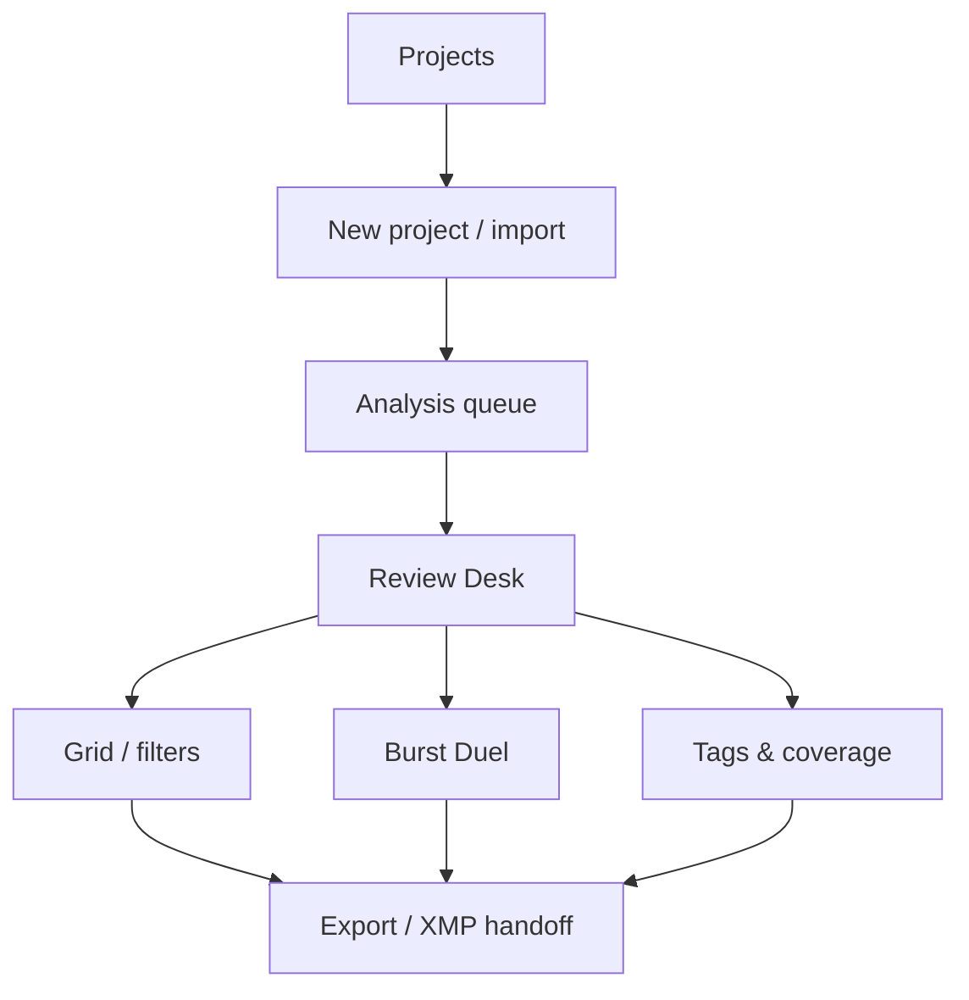
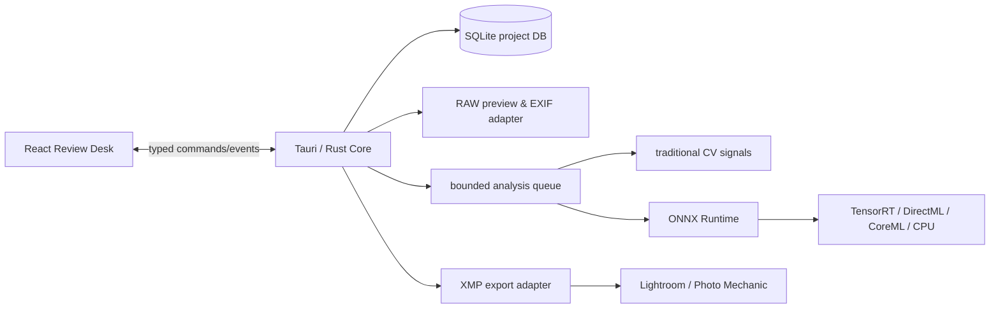
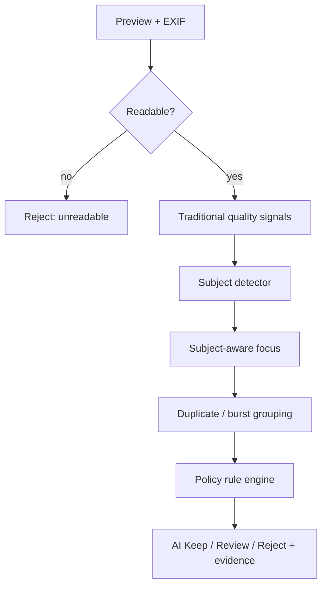

# FrameScout Master Specification

> **Document type:** Product requirement, UX specification, technical architecture and engineering handoff  
> **Status:** v1.0 — approved starting point  
> **Audience:** local Codex / engineering agents, product designer, ML engineer, test engineer  
> **Last updated:** 2026-07-11

## 0. One-sentence product

**FrameScout is a beautiful, local-first desktop review room for sports, motorsport and esports photographers: it clears technical garbage, groups bursts, shows its evidence, lets the photographer decide at speed, and hands the result back to Lightroom/Photo Mechanic without touching an original.**

The product is not a generic AI gallery, a cloud delivery portal, a Lightroom clone, or an automatic “best photo” oracle. Its job is to make the first 80% of repetitive reviewing disappear while protecting the final 20% of human taste.

---

## 1. Product position and competitive take

### 1.1 What to learn from Pianke — and what not to copy

Pianke is a strong reference because it is local, groups similar frames, removes obvious rejects and then gives the photographer a fast A/B “arena” for the final call. Its own README frames the idea correctly: AI assists the initial grouping and culling while the photographer keeps aesthetic authority. It also handles RAW/JPEG pairing and resumable selection. [Pianke repository](https://github.com/zhaoyue4810/pianke)

FrameScout should learn these principles:

1. **A group is a moment, not a folder.** A burst needs comparison, not a 200-thumbnail wall.
2. **The machine proposes; the photographer commits.** No hidden automatic deletion.
3. **Local processing is a product feature.** Sport/event work can be sensitive, huge and time-critical.

FrameScout must not become a reskin or a fork. Its differentiators are:

| Pianke-inspired strength | FrameScout’s extension |
| --- | --- |
| General photo grouping | Sport/esports project presets, including aggressive “action-only” triage and safe “matchday story” review |
| A/B duel for aesthetic choice | A **Review Desk** that starts with AI evidence, subject loupe and one-keystroke decisions; duel is a deliberate sub-mode |
| Generic obvious-reject handling | Subject-aware focus, empty-frame handling, burst coverage and domain tags |
| Local UI | Professional visual system, instant keyboard flow, XMP-safe export and a performance budget for high-volume RAW |

The mature reference tools validate several non-negotiables: Photo Mechanic has built its reputation on fast ingest, captioning, keywords and export; it should remain an interoperable neighbour, not a target to replace. [Camera Bits](https://home.camerabits.com/) Narrative emphasizes immediate browsing, focus/eye evidence and human final judgement, while Aftershoot explicitly keeps culling local and non-destructive through sidecars. [Narrative Select](https://narrative.so/select) [Aftershoot](https://aftershoot.com/)

### 1.2 Product thesis

Sports photographers do not want an “AI score of beauty.” They want confidence that they are not wasting brainpower on frames that are indisputably unusable, and they want to move through thousands of remaining frames at the speed of their left hand.

The emotional promise is not “AI will replace your judgement.” It is:

> “Every frame you see deserves a second of your attention.”

### 1.3 Target users

| Persona | Workflow / pain | FrameScout outcome |
| --- | --- | --- |
| **Sports sideline shooter** | 2,000–8,000 RAWs, deadline, many out-of-focus or empty frames | Action preset filters hard rejects and makes a usable shortlist immediately |
| **Motorsport photographer** | Long high-speed bursts, deliberate panning blur, cars rather than people in many frames | “Vehicles + people” subject policy; never use a person-only rule as universal truth |
| **Esports stage photographer** | Low light, LEDs, smoke, player reactions, audience and gameplay screens | Low-light focus evidence; scene labels for stage/player/team/crowd/screen; no cloud upload by default |
| **Photo editor / team lead** | Needs coverage of athletes, teams and match story, not merely sharpness | Filterable tags and later coverage map; export a reviewable XMP decision set |
| **Advanced hobbyist** | Wants a gorgeous faster first pass, not an enterprise DAM | A simple first-run project and an understandable “why” for every AI flag |

### 1.4 Explicit non-goals through v1

- Retouching, generative fill, full colour editing, social publishing, cloud client galleries, sales, billing, FTP delivery.
- Replacing Lightroom, Capture One or Photo Mechanic as a complete asset manager.
- Naming an athlete, team or score from an image without a user-confirmed source.
- Deleting, moving, renaming or modifying a RAW as part of a selection action.
- Promising that “no people” equals “bad” in every project.

---

## 2. Product scope and key decisions

### 2.1 The decision hierarchy

Every image has two separate classifications. Keep them separate in code, storage and UI.

1. **Technical disposition** (AI-assisted, objective-ish): `keep`, `review`, `reject`.
2. **Photographer’s editorial pick** (human): `unseen`, `candidate`, `select`, `hold`, `reject`.

AI is allowed to set a *provisional* technical disposition. It may never overwrite an explicit human editorial pick.

### 2.2 Project presets

The import screen asks one question that meaningfully changes the rules. It cannot be buried in Settings.

| Preset | Empty frame policy | Detection classes | Intended use |
| --- | --- | --- | --- |
| **Action coverage** | Reject if no athlete/person is confidently detected | person, ball/racket optional later | Fast sideline, court, field action |
| **Matchday story** (default) | Review if no person; never auto-reject | person, crowd, trophy, venue | Editorial match coverage, event storytelling |
| **Motorsport** | Reject only if no vehicle **and** no person | vehicle, person, helmet optional | Racing / panning |
| **Esports stage** | Review if no person; retain screen/stage/crowd | person, monitor/screen, crowd | VCT/LoL stage, player reactions, venue |
| **Custom** | User chooses reject / review / ignore | User selects allowed subjects | Any unusual job |

This is the answer to the “no person” problem: it is highly useful for one job and dangerously wrong for another.

### 2.3 AI dispositions and evidence

| Disposition | Meaning | Default UI treatment | Required evidence |
| --- | --- | --- | --- |
| `AI Reject` | Strong technical failure; hidden from default review but always recoverable | Darkened filmstrip; not deleted | At least one concrete reason: subject soft, no allowed subject, corrupt preview, severely unusable exposure |
| `AI Review` | Ambiguous or intentionally preserved odd frame | Visible in review queue | Reason and confidence, e.g. “no athlete detected; matchday preset preserves it” |
| `AI Keep` | Passed technical first pass | Normal | A quiet indicator, not a big “AI score” |
| `Human select` | Photographer wants it | High-saturation selection accent | Human action always wins |

**No single opaque score is shown as the product’s main answer.** An optional detail panel can expose component signals for experts.

---

## 3. Experience and visual design

### 3.1 Design north star: “the review desk, not the dashboard”

The interface must feel like sitting at a well-built editing desk in a dark room, with a fast camera browser underneath—not like a SaaS analytics dashboard.

It should be calm, dense where it needs to be, almost invisible while reviewing, and very deliberate in its motion. The image occupies the visual hierarchy. Chrome exists to reduce thought, not advertise features.

**Visual adjectives:** midnight, precise, photographic, athletic, editorial, physical, confident, restrained.

**Avoid:** generic purple gradients, neon gamer chrome, card-grid dashboards, AI sparkle icons, oversized rounded white panels, fake “minimalism” that hides essential metadata.

### 3.2 Visual direction: *Midnight Pit Wall*

The product uses a near-black graphite workspace with cool-neutral surfaces so actual colour work remains credible. Accent colour communicates state only.

| Token | Value | Use |
| --- | --- | --- |
| `canvas` | `#0B0D10` | Main review background |
| `surface-1` | `#13171C` | Rails, inspector |
| `surface-2` | `#1B2128` | Hover / active controls |
| `line` | `#2B333C` | Dividers, thumbnail borders |
| `text-primary` | `#F3F5F7` | Core information |
| `text-muted` | `#9AA5B1` | Metadata / secondary labels |
| `keep` | `#6EDC9A` | Human selection / healthy state |
| `review` | `#F4B740` | Attention / uncertain state |
| `reject` | `#F06464` | Technical rejection only |
| `focus` | `#7BA7FF` | Keyboard focus / neutral AI evidence |
| `brand` | `#DCE8FF` | Wordmark and sparse hero accent |

Colour is never the only signal. Every state also has an icon, text label and keyboard action.

Typography:

- UI: **Inter** or **Geist**, variable font, optical size enabled where available.
- Metadata / shortcut badges: **JetBrains Mono** or **IBM Plex Mono**.
- No decorative display font in the working UI. The photographs are the art direction.

Geometry:

- 8 px spacing grid.
- Radius: 6 px for controls, 10 px for floating sheets, no inflated pill universe.
- Hairline dividers at 1 px; thumbnail edges use a 2 px state border only when active/selected.
- Animation: 120–180 ms, ease-out. Never animate a full-size RAW preview on navigation; it must swap immediately.

### 3.3 Accessibility and calibration

- WCAG AA text contrast in normal UI; state colour must have text/icon redundancy.
- All review actions keyboard accessible; strong visible focus ring using `focus` token.
- UI scale 80–160%, with no loss of shortcut visibility.
- Separate **Interface brightness** from image display background. Do not apply a colour-transforming “pretty” overlay on photos.
- Respect OS reduce-motion setting.

### 3.4 Information architecture



Global navigation is deliberately small:

| Area | Purpose |
| --- | --- |
| Projects | Recent jobs and resumable review state |
| Import | Create a project, choose preset, files and safety options |
| Review Desk | Primary one-image flow |
| Grid | Fast overview and filterable contact sheet |
| Duel | Compare a burst/group deliberately |
| Export | XMP preview and hand-off confirmation |

No “Analytics” page in v1.

### 3.5 Screen specifications

#### A. Projects / welcome

**Goal:** make first entry feel premium and not intimidating.

- One large primary action: `New review`.
- Recent projects are horizontal full-bleed photo strips, not anonymous cards: cover preview, project name, status, source folder, decision counts, last opened.
- A compact lower section: `Open existing project`, `Settings`.
- Empty state shows one tasteful editorial photo crop and a three-step sentence; no illustration army.

#### B. New review / import

**Goal:** make scope and safety explicit before analysis.

Layout: left narrative column, right source folder drop-zone / project summary.

Steps are on one sheet, not a multi-page wizard:

1. Project name + source folders.
2. Preset selector as five compact visual tiles. Each tile describes what will be preserved or rejected.
3. `Keep originals untouched` is present and locked on; text says decisions are stored locally until XMP export.
4. Analysis controls in an expandable “Advanced” section: GPU, model bundle, no-person policy, thumbnail cache path.
5. `Start local analysis` button gives predicted count, not fake time certainty.

#### C. Analysis queue

**Goal:** make long processing reassuring, not ornamental.

- Background preview mosaic slowly populates with real results.
- The only metrics: images discovered, previews ready, AI review ready, model backend (e.g. RTX / CPU). No circular “AI thinking” theatre.
- User can enter review as soon as the first 100 images are ready.
- A small live log is collapsible for troubleshooting.

#### D. Review Desk — the hero screen

**Goal:** let a photographer decide a frame in <1 second without losing context.

Layout at 1440×900:

```text
┌─────────────────────────────────────────────────────────────────────────────┐
│ Project / preset   1,284 reviewed · 43 selected    Queue: AI Keep     ⌘K   │
├──────────────┬───────────────────────────────────────┬─────────────────────┤
│ FILTER RAIL  │                                       │ EVIDENCE INSPECTOR  │
│ All          │             FULL IMAGE                │ AI REVIEW           │
│ AI Keep      │         fit / 100% / loupe            │ ✓ subject sharp     │
│ AI Review    │                                       │ 2 people · close    │
│ AI Reject    │                                       │ exposure usable     │
│              │                                       │                     │
│ Tags         │                                       │ EXIF                │
│              │                                       │ 1/1000 · ISO 12800  │
├──────────────┴───────────────────────────────────────┴─────────────────────┤
│ Filmstrip  [thumb] [thumb] [thumb] [active] [thumb]                         │
│  X Reject     1 Candidate    2 Select    3 Hold    Space zoom    ← → next  │
└─────────────────────────────────────────────────────────────────────────────┘
```

Rules:

- The central image has 68–78% of the usable screen width when the inspector is collapsed.
- Inspector defaults to 280 px and can be hidden with `I`; the app remembers the preference by project.
- The focus loupe is not a floating magnifier users must chase. When an AI focus decision is questioned, press `F`: it opens a stable 1:1 subject crop beside the image, with the detected subject box briefly outlined.
- Clicking a reason chip filters into the corresponding image subset only after a confirmation affordance; accidental context jumps are bad.
- The filmstrip must accept drag selection only in Grid mode. In Review Desk it is navigation, not a tiny touch target.

#### E. Grid / contact sheet

**Goal:** regain overview without turning review into a spreadsheet.

- Responsive 3–9 column density controlled by `[` and `]`.
- Each thumbnail only shows the essential overlay: disposition colour line, human pick glyph, optional group count. Hover reveals AI reason / file number.
- Filter drawer combines state, tag, capture time, rating, camera, and group. Saved filters: `Needs review`, `No athlete`, `Soft focus`, `Selected`.
- Multi-select actions are constrained to **set decision**, **apply manual tag**, **open duel**, **export preview**. Nothing destructive.

#### F. Burst Duel

**Goal:** use Pianke’s useful “arena” concept without making it the whole app.

- Enter from a burst/group with `D`.
- Two candidates fill the center, same crop scale; the rest of the group is a numbered vertical stack.
- `←` chooses left, `→` chooses right, `↑` pins both, `X` rejects the weaker technical frame, `Z` undo.
- Show a quiet “AI sees: right subject sharper” line only when supported by evidence; never cover the photo with a score badge.
- Exit returns to the exact filmstrip position and preserves every decision.

#### G. Tags & coverage

**Goal:** reveal missing coverage for an editor without pretending to understand match narrative.

- Filterable tag list and compact counts: `player`, `coach`, `crowd`, `stage`, `screen`, `trophy`, `venue`, plus custom tags.
- “Coverage” is a filter matrix, not an automatic story judgement. It answers “do I have any selected crowd images?”
- In v1, auto-tags are conservative scene suggestions. Athlete/team names require a human tag or confirmed roster import.

#### H. Export / hand-off

**Goal:** provide a calm irreversible-action checkpoint.

- Plain-language preview: number of XMP files to add/update, which ratings/labels/keywords will be written, no original files modified.
- Diff preview for 3 sample existing sidecars.
- Actions: `Write XMP sidecars`, `Export CSV report`, `Copy selected paths`, `Open in Lightroom folder`.
- Never fake a one-click import into Lightroom until the bridge is tested on both Windows and macOS.

### 3.6 Keyboard map (v1)

| Key | Action |
| --- | --- |
| `←` / `→` | Previous / next image or choose left/right inside Duel |
| `1` | Candidate |
| `2` | Select |
| `3` | Hold / needs editor review |
| `X` | Human reject |
| `A` | Toggle AI Reject visibility |
| `F` | Subject-focus loupe |
| `D` | Open / exit Duel for current group |
| `G` | Grid |
| `I` | Inspector |
| `[` / `]` | Grid density |
| `T` | Add manual tag |
| `Z` / `Shift+Z` | Undo / redo |
| `?` | Shortcut overlay |

Shortcuts are never modal mysteries: pressing and holding `?` displays them as a translucent bottom rail without obscuring the active photo.

---

## 4. Function requirements

### 4.1 Ingest and project persistence

| ID | Requirement | Acceptance criterion |
| --- | --- | --- |
| FR-01 | Create a project from one or multiple folders without copying originals | The project opens after restart and records original absolute paths + immutable file identity |
| FR-02 | Support Canon CR2 first, then CR3/NEF/ARW/RAF/DNG/JPEG/HEIC | A fixture corpus opens an embedded preview without full RAW decode where one exists |
| FR-03 | Pair RAW+JPEG by configurable same-stem rule | A decision on JPEG writes to the paired RAW’s XMP target, visible in preview |
| FR-04 | Allow resume and crash-safe progress | Kill during analysis; reopen with all prior results and decisions intact |
| FR-05 | Detect moved/missing source files | Project lists missing assets and offers relink; it does not create duplicate records |

### 4.2 Technical triage

| ID | Requirement | Acceptance criterion |
| --- | --- | --- |
| FR-10 | Measure sharpness globally and on detected allowed subjects | Report exposes both signals; subject result wins when valid |
| FR-11 | Detect allowed subjects according to project preset | A confident zero detection follows the preset’s empty-frame policy; unavailable detector results in `unknown`, never `empty` |
| FR-12 | Detect technical issues: soft focus, severe under/overexposure, unreadable preview | Each AI Reject has one or more machine-readable reason codes and visible plain-language evidence |
| FR-13 | Group near-duplicate/burst images | Grouping is deterministic for same input/model version; user can split/merge a group |
| FR-14 | Produce tags | Every analysed image has `system:*` provenance and additive tags; manual tags are never overwritten |
| FR-15 | Never silently hide a human pick | Human candidate/select/hold always appears in normal queues even if AI rejected it |

### 4.3 Human review and labels

| ID | Requirement | Acceptance criterion |
| --- | --- | --- |
| FR-20 | One-key decisions, undo/redo and queue navigation | 100 decisions + undos complete without mouse in usability test |
| FR-21 | Explain AI flags | Inspector shows reason, confidence/threshold, model version, subject crop when applicable |
| FR-22 | Human tags | Add/remove tags in Grid or Desk; manual tag origin is stored |
| FR-23 | Review AI rejects | Toggle exposes every reject in original capture order; no hidden dead-end queue |
| FR-24 | Edit project policy | Changing policy recomputes only disposition, preserving detection and human decisions |

### 4.4 Metadata and export

| ID | Requirement | Acceptance criterion |
| --- | --- | --- |
| FR-30 | Stage all decisions in SQLite before export | A project can be fully reviewed without a single XMP file appearing on disk |
| FR-31 | Write standards-compatible XMP sidecars | Lightroom Classic reads star rating, colour label and keywords after metadata refresh |
| FR-32 | Preserve existing XMP fields and non-system keywords | Snapshot test proves unknown fields remain byte-equivalent where practical / semantically identical after XML serialization |
| FR-33 | Export reversible metadata map | CSV/JSON includes file, decision, tags, reasons, timestamps, model version |
| FR-34 | No automatic file movement/deletion in v1 | Attempting batch export has no source filesystem mutation other than explicit `.xmp` creation/update |

---

## 5. Tag taxonomy and decision data model

### 5.1 Tag namespaces

Tags must be additive and namespaced. Users should not be left with an ugly soup of generic AI keywords.

| Namespace | Examples | Producer | Export default |
| --- | --- | --- | --- |
| `system:` | `system:framescout`, `system:model-2026.1` | app | no (internal) |
| `quality:` | `quality:sharp`, `quality:soft`, `quality:underexposed` | algorithm | optional |
| `subject:` | `subject:person`, `subject:vehicle`, `subject:screen`, `subject:close` | detector | optional |
| `scene:` | `scene:stage`, `scene:crowd`, `scene:trophy` | model/manual | optional / review first |
| `reason:` | `reason:out-of-focus`, `reason:no-allowed-subject` | rule engine | no by default |
| `event:` | `event:valorant`, `event:grand-final` | human/import | yes |
| `team:` / `athlete:` | `team:EDG`, `athlete:…` | human/confirmed roster | yes |
| `user:` | `user:hero`, `user:coach-reaction` | human | yes |

**XMP mapping:** default sidecar keywords include human tags plus a small configurable subset of `subject:` / `scene:`. AI reason tags should be opt-in: they are useful to debug but pollute a real archive.

### 5.2 Core entities

```text
Project
  id, name, preset, source_roots, created_at, policy_version, app_version

Asset
  id, project_id, source_path, file_fingerprint, raw_partner_id, capture_at,
  exif_json, preview_state, missing_state

AnalysisRun
  id, project_id, model_bundle_version, backend, started_at, completed_at

Signal
  asset_id, run_id, kind, value, confidence, region_json, evidence_json

BurstGroup
  id, project_id, capture_range, grouping_version

Decision
  asset_id, ai_disposition, human_disposition, reasons[], changed_at, actor

Tag
  id, name, namespace, source(ai|human|import), confidence, asset_id

ExportRun
  id, project_id, type, staged_items, completed_at, report_path
```

**Invariants:**

- Asset fingerprint plus project identity is unique.
- Every human decision appends a reversible history event.
- `human_disposition != unseen` cannot be overwritten by re-analysis.
- A model run is immutable; re-analysis creates a new run and links its result.
- XMP is an export projection, not the primary project database.

---

## 6. Technical architecture

### 6.1 Chosen production architecture

| Layer | Choice | Why |
| --- | --- | --- |
| Desktop shell | **Tauri 2** | Small native desktop distribution, secure local filesystem control, Rust integration |
| UI | **React + TypeScript + Vite** | Fast interaction state, mature component/test ecosystem, designer-friendly implementation |
| UI styling | CSS variables + Tailwind utilities *or* vanilla-extract; no unthemed component kit | Token control and a bespoke professional look matter more than a generic UI library |
| Native core | **Rust** | Safe concurrent ingest, fast hash/preview work, single distributable |
| Local persistence | **SQLite + SQLx migrations** | Portable project database, durable queues, deterministic test fixtures |
| Image/RAW preview | LibRaw-backed adapter; embedded preview first | Start with Canon CR2 (6D2) and preserve speed; full decode only as fallback |
| ML inference | ONNX Runtime through Rust binding / sidecar | One model format with TensorRT/CUDA, DirectML, CoreML and CPU fallback |
| Background work | Tokio queue + bounded worker pool | Avoid UI starvation and GPU memory spikes |
| Crash reporting | Local, opt-in diagnostic bundle | Privacy-first; no automatic asset upload |

Why not a Python production app? The existing Python prototype is useful for validating algorithms, but a Tauri/Rust product will better handle file permissions, RAW preview throughput, distribution, safe queues and a polished native UI. Python remains valid for offline model evaluation/training tooling.

### 6.2 Process topology



### 6.3 Repository plan

Do not make one giant `app.tsx`. Create a workspace with contracts at the boundary.

```text
framescout/
  apps/
    desktop/
      src/                 # React screens, state, tokens, components
      src/features/review/ # desk, grid, duel, shortcuts
      src/features/import/
      src/features/export/
      src/styles/
    desktop/src-tauri/
      src/commands/        # thin typed command handlers
      src/main.rs
  crates/
    domain/                # entities, decision invariants, tag policy
    ingest/                # discovery, pairing, fingerprints, EXIF
    previews/              # embedded preview / fallback decoder
    vision/                # models, ORT provider selection, signal schema
    grouping/              # pHash, embeddings, temporal grouping
    metadata/              # XMP read/merge/write
    storage/               # SQLx repository, migrations
    test-fixtures/         # generators; never actual private photos
  packages/
    contracts/             # TypeScript command/event types generated/shared
    design-tokens/         # token JSON + CSS generation
  models/
    manifests/             # version, hashes, license, classes, thresholds
  tools/
    evaluate/              # Python notebooks/scripts, dataset manifests
    benchmark/
  tests/
    e2e/
    golden/
  docs/
    framescout-master-spec.md
  AGENTS.md
```

### 6.4 Typed UI/native contract

All commands must use explicit request/response shapes. Never send raw arbitrary SQL or file paths directly from the renderer.

Essential commands:

| Command | Input | Output |
| --- | --- | --- |
| `project.create` | roots, preset, settings | project summary |
| `analysis.enqueue` | project id, priority | queue state |
| `review.next` | queue, cursor, filters | asset + preview URL + evidence |
| `decision.set` | asset id, human disposition, optimistic revision | updated decision event |
| `tag.apply` | asset ids, tag mutation | tag event |
| `group.open` | group id | ordered assets + comparison evidence |
| `export.preview` | project id, export options | sidecar diff summary |
| `export.commit` | confirmed plan id | export run |

Events are one-way and typed: `analysis.progress`, `preview.ready`, `asset.updated`, `project.relinked`, `export.complete`.

### 6.5 Performance budget

The user’s actual environment may include an RTX 5080, but the app must remain graceful on a laptop.

| Operation | Target |
| --- | --- |
| Switching ready previews with arrows | ≤50 ms UI response; no blocking synchronous decode |
| Open first reviewable image after folder select | ≤5 s for a normal folder with embedded previews |
| Thumbnail memory | bounded cache; eviction transparent to UI |
| Queue concurrency | configurable and automatically reduced under low RAM/VRAM |
| 5,000 image project | no renderer freeze; progress survives restart |
| RTX path | batch detector/embedding jobs, but preserve one GPU lane for UI/other apps when configured |

---

## 7. Image intelligence: algorithms, models and policy

### 7.1 Principle: use the cheapest reliable signal first

The system evaluates in gates. This makes it fast, explainable and avoids spending GPU time on hopeless/corrupt previews.



### 7.2 Model and algorithm registry

| Job | v1 method | Why | Later refinement | Must not do |
| --- | --- | --- | --- | --- |
| Preview quality | Embedded JPEG / RAW preview + EXIF | Fast; enough to triage | RAW low-res fallback | Full RAW develop on every asset |
| Global sharpness | Laplacian variance, Tenengrad/edge energy, JPEG artifact guard | Deterministic and explainable | Learn camera/ISO normalized threshold | Call a panned car a reject based only on global edges |
| Allowed subject detection | Small COCO-class object detector exported to ONNX (person; vehicle for motorsport) | Handles occlusion/scale much better than rules | Custom sport fine-tune after consented data | Mark `no person` when model was unavailable |
| Subject-focus score | Crop on detector box, calculate traditional focus features there; compare with global | Solves blurred-background / sharp-player issue | Small learned focus-quality classifier | Use face-only focus for helmet/back/remote athlete |
| Exposure | Luminance histogram, highlight/shadow clipping, local contrast | Explainable | Scene-aware low-light classifier | Reject dramatic silhouette without preset policy |
| Similarity grouping | Capture-time window + pHash/dHash + image embedding | Cheap candidates then semantic grouping | User merge/split feedback | Group across unrelated match periods merely because jerseys match |
| Embeddings | DINOv2-small or equivalent permissively licensed visual encoder in ONNX | Strong visual similarity for burst/scenes | Distill / quantize for distribution | Treat similarity as editorial quality |
| Eyes / expression | Optional face detector + landmarks only when face box is large enough | Useful for portraits/reactions | Domain validation for esports close-ups | Apply to distant or helmeted athletes |
| Scene suggestions | CLIP-style zero-shot labels, always `review` confidence | Useful discovery for stage/crowd/trophy | Fine-tuned taxonomy | Export an unconfirmed team/player name |
| OCR | PaddleOCR-equivalent local ONNX pipeline, off by default | Can suggest jersey/scoreboard text | Roster reconciliation | Claim score/identity as truth without confirmation |
| Personal learning | Calibrated LightGBM/logistic ranking over signals + user corrections | Needs little data, inspectable features | Per-project/per-user model | Train a cloud model from photos without opt-in |

### 7.3 Licensing gate

Codex must create a `models/manifest.json` for every downloadable model containing: source URL, exact license, redistribution permission, SHA-256, input size, classes, quantization, benchmark date and required attribution.

Do **not** assume a popular YOLO package is safe to bundle in a commercial desktop app; Ultralytics licensing needs deliberate review. The development baseline may use it locally, but the release candidate needs a documented permissive/commercially licensed alternative or a purchased license. Model licence review is a release gate, not a README footnote.

### 7.4 Rules engine: examples

```text
if preview_unreadable:
    AI Reject(reason=unreadable_preview, confidence=1.0)

elif allowed_subject_detector.status == unavailable:
    never infer no_subject
    AI Review(reason=subject_detector_unavailable) only if policy needs it

elif allowed_subject_count == 0:
    Action coverage -> AI Reject(reason=no_allowed_subject)
    Matchday story / Esports -> AI Review(reason=no_allowed_subject)

elif subject_focus < calibrated_threshold(camera, ISO, subject_size):
    AI Reject(reason=subject_out_of_focus)

elif global_focus weak and subject_focus strong:
    AI Keep(reason=subject_is_sharp)

else:
    AI Keep
```

No rule has permission to erase an asset. The exact threshold and contributing metrics are stored as `Signal` records.

### 7.5 Data loop and evaluation

The app writes an **on-device correction ledger** whenever a user changes an AI result:

```text
asset_id, project_preset, camera, lens, ISO_bucket, signal_vector,
ai_disposition, human_final_disposition, model_version, timestamp
```

The local personal model is opt-in and trained only from that ledger. An explicit `Export anonymized evaluation package` can create a user-reviewed package; it never leaves the machine by itself.

Evaluation datasets are divided by event, venue and photographer to prevent near-duplicate leakage. Report at minimum:

| Metric | Definition | v1 target |
| --- | --- | --- |
| Reject recall | Fraction of human-labelled hard technical rejects that are AI Reject/Review | ≥95% |
| False-reject rate | Fraction of human keep/select frames AI marked Reject | ≤3%; report by preset |
| Empty-frame precision | Fraction of no-subject AI labels confirmed by reviewer | ≥97% in Action preset |
| Time-to-first-review | Folder select to usable first preview | ≤5 sec target |
| Review velocity | Confirmed decisions/minute, compared with baseline | ≥2× after onboarding |

---

## 8. Testing and quality plan

### 8.1 Tooling

| Layer | Tooling | What it proves |
| --- | --- | --- |
| Rust unit | `cargo test`, `proptest` | Domain invariants, rule policy, XMP merging, path pairing, queue behaviour |
| Rust integration | temporary dirs + SQLite fixtures | Ingest, restart/resume, export transaction and relink behaviour |
| TypeScript unit | Vitest + Testing Library | Reducers, hooks, shortcut dispatch, inspector rendering |
| Visual regression | Playwright screenshot tests at 1440×900 and 1280×800 | Token, layout and state regressions on hero screens |
| Desktop E2E | `tauri-driver` + WebdriverIO (or the current Tauri-recommended harness) | Native file dialogs mocked, decisions, restart, export confirmation |
| ML unit | Python `pytest`, ONNX golden tensors | Pre/postprocessing and output schema stability |
| ML evaluation | Python evaluation CLI + immutable dataset manifest | Recall, false rejection, calibration by preset |
| Performance | Criterion (Rust) + benchmark project fixtures | Queue throughput, cache bounds, UI responsiveness events |
| Security | cargo audit / Dependabot equivalents, path traversal tests | No arbitrary file writes, signed model bundles |

### 8.2 Test fixtures

Never commit personal/private sport photos to a public repository. Create a fixture strategy:

- Synthetic checkerboard/blur/exposure images for deterministic algorithm tests.
- Openly licensed, manually annotated small evaluation set for CI.
- Local untracked “real-world” dataset manifest for developer benchmark, not the imagery itself.
- Golden XMP sidecars containing unknown fields, namespaces and existing Lightroom tags.
- RAW fixture corpus with license/provenance recorded; Canon CR2 must be covered first.

### 8.3 Mandatory acceptance scenarios

1. **Subject sharp, background blurred:** system does not reject when person crop is sharp.
2. **Panned race car:** Motorsport preset does not reject because global edge score is low when vehicle detector/focus signal supports intent.
3. **Empty arena image:** Matchday Story leaves it in Review; Action Coverage can reject it; changing policy recomputes without losing human tags.
4. **Detector absent:** system displays `subject detection unavailable`; it never calls an image empty.
5. **Low-light esports player:** image can remain Keep when subject crop is reasonably sharp despite high ISO noise.
6. **Human rescue:** user selects an AI Reject; it stays selected after re-analysis and after restart.
7. **XMP preservation:** existing author/copyright/custom keyword fields survive sidecar export.
8. **Recovery:** kill process mid-analysis, reopen project, and see all prior review decisions.
9. **Keyboard-only:** complete 100 keep/review/reject actions and undo ten of them without a mouse.
10. **No accidental mutation:** a full import/review/export-preview run creates no source changes; confirmed export writes only expected XMP files.

### 8.4 Definition of done for any feature

A feature is not done because its UI appears. It is done only when it has:

1. A requirement ID and an acceptance scenario.
2. Typed domain contract and error state.
3. Unit or integration tests for behaviour.
4. Loading, empty, failure and keyboard states.
5. Visual regression for a changed hero UI state.
6. Accessibility check and no hard-coded colour outside tokens.
7. A performance implication recorded if it touches previews, queues or inference.

---

## 9. Implementation sequence for local Codex

Each phase is a vertical slice. Do not build models, a dozen screens and an export system in parallel.

### Phase 0 — foundation and visual system (3–5 days)

**Deliverables**

- Tauri 2 + React workspace and CI.
- Design token package implementing the Midnight Pit Wall system.
- Fake in-memory project data and navigable Projects / Import / Review Desk / Grid screens.
- Keyboard map, focus behaviour, component primitives and screenshot tests.

**Exit criteria:** Review Desk looks deliberate at 1440×900, passes keyboard navigation, and uses fake photos without any production ML.

### Phase 1 — safe project and preview vertical slice (5–8 days)

**Deliverables**

- Folder project creation, SQLite schema/migrations, JPEG plus Canon CR2 embedded preview, thumbnail cache, restart/resume.
- Review Desk drives actual local assets.
- No AI yet; human decisions and undo/redo persist.

**Exit criteria:** Open 500 real files, review/restart, and no original is changed.

### Phase 2 — deterministic technical triage + XMP (5–8 days)

**Deliverables**

- Global quality signals, rule engine, evidence inspector, empty-policy presets.
- Read/merge/write XMP sidecars behind explicit Export preview.
- Golden XMP suite and Lightroom verification checklist.

**Exit criteria:** v1 rejection reasons are visible, recoverable and safely exportable.

### Phase 3 — local person/vehicle detection and subject-focus (8–12 days)

**Deliverables**

- ONNX model manifest/downloader, provider selection, offline model run, detector availability state.
- Person + vehicle preset policy, box crop loupe, subject-aware focus.
- GPU/CPU benchmarks and annotated evaluation report.

**Exit criteria:** Meet false-reject / reject-recall targets on separate real-world validation jobs.

### Phase 4 — bursts, Duel and tags (6–10 days)

**Deliverables**

- Time/hash grouping, user merge/split, Duel, manual tags, tag filtering/coverage.
- Optional embedding model only after baseline grouping evaluation.

**Exit criteria:** A 1,000-frame burst job can be triaged and compared faster than the user’s Lightroom baseline.

### Phase 5 — personal calibration and polish (ongoing)

**Deliverables**

- Correction ledger, opt-in local calibration, settings/explainability, performance/failure polish, installer/update mechanism.

**Exit criteria:** The user prefers it for three consecutive real jobs and can explain why it made each job faster.

### Phase 6 — only after the above is trusted

- Esports scene tags/OCR/roster-assisted review.
- Photo Mechanic/Lightroom quality-of-life integrations.
- Team handoff / shared review, only with a privacy and rights design.

---

## 10. Codex working protocol

When assigning this to a local Codex agent, give it this instruction in addition to the repository:

```text
Read AGENTS.md and docs/framescout-master-spec.md fully before touching code.
Implement only the next unfinished phase. Do not add cloud dependencies or mutate
source photos. First inspect the existing repository and tests, then propose a
short implementation plan. Build one vertical slice with tests, run the relevant
test suites, and report which acceptance criteria passed or remain blocked.
Keep all visual work aligned with “Midnight Pit Wall”; do not substitute a generic
component-library dashboard. If a model license or RAW library support is unclear,
stop and document the decision rather than guessing.
```

Suggested first local Codex task:

```text
Implement Phase 0 of FrameScout from docs/framescout-master-spec.md. Build only
the navigable React/Tauri review shell with in-memory fixture data, design tokens,
the Review Desk and Grid hero screens, keyboard navigation, and visual-regression
tests. No ML, filesystem ingest or XMP yet. Show screenshots and report test results.
```

---

## 11. Open decisions requiring real-user validation

These are intentionally not guessed away. Capture them after 2–3 real projects.

1. Whether `Candidate` and `Select` are enough, or sports workflow genuinely needs `Hold`.
2. The preferred Lightroom colour-label mapping. FrameScout’s internal semantics must not overwrite an existing personal label convention.
3. Whether photographers prefer a persistent right inspector or an almost entirely image-only desk.
4. Default Action Coverage threshold by camera/ISO; do not infer it from web photos.
5. The correct baseline model and licence for distribution.
6. Whether esports “gameplay screen” should be an automatic keep/review class; it may be useful context, or visual junk, depending on assignment.
7. Whether the product is personal/open source, paid desktop, or a business. This affects model licensing, telemetry and update design, but not the local-first core.

## 12. Final quality bar

If the first impression is “this is a normal AI tool with photos inside it,” the product failed. The first impression should be: **“this feels like someone who shoots fast, cares about their frames, and finally designed the review tool properly.”**
