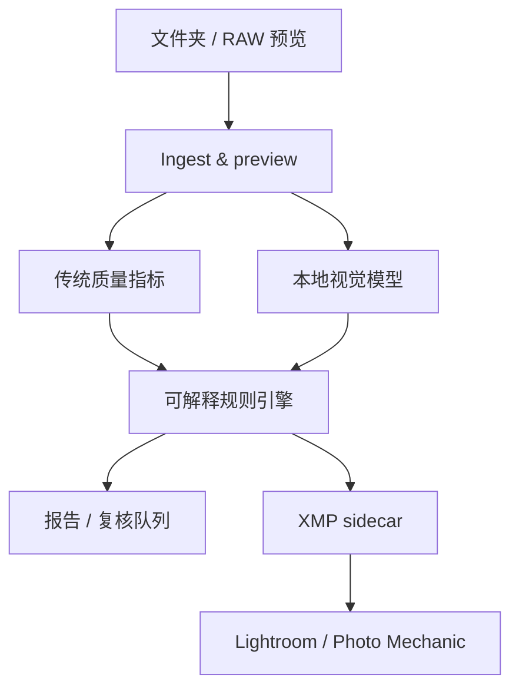

# FrameScout — 产品分析与首版计划

## 1. 需求结论

**目标用户**：体育、赛车和电竞现场摄影师；他们会在一场比赛后面对大量 RAW 连拍，并使用 Lightroom Classic / Photo Mechanic 交付。

**首要任务**：做第一筛，不是替代审美。系统应找出失焦、没有人、极端曝光或明显技术失败的画面，并给可用画面写入可搜索标签。摄影师仍自己判断表情、构图、叙事和“最关键的一帧”。

**非目标（MVP）**：自动修图、云端图库、自动发布、按“比赛高光”决定最终精选、根据选手身份作新闻事实断言。

### 用户故事

| 用户 | 触发 | 结果 |
| --- | --- | --- |
| 篮球/足球摄影师 | 一场 3,000 张连拍导入 | 先只看 `AI Keep` / `AI Review`，失焦和空镜已落为 Reject |
| 电竞摄影师 | 低照度舞台拍摄后 | 找到清晰的人像、多人队伍、远景/近景；不用把现场图上传到云端 |
| 自由摄影师 | 想进 Lightroom 继续修 | 自动输出 XMP rating、label 和 keyword，不复制、不改 RAW |

### 成功指标

| 指标 | MVP 验收阈值 |
| --- | --- |
| 技术废片召回率 | 人工标为“失焦/空镜”的图片，≥95% 被标为 Reject 或 Review |
| 误杀率 | 人工保留的图片中，≤3% 被直接 Reject |
| 速度 | 2,000 张 JPEG 预览在中端 GPU/现代 CPU 上完成分析；具体 SLO 在基准集确定后锁定 |
| 工作流可靠性 | 100% 保留原图；写 sidecar 前必须显式 `--write-xmp` |

## 2. 竞品调研（2026-07-11）

| 产品 | 已做得好 | 对本产品的启发/空白 |
| --- | --- | --- |
| Photo Mechanic | 快速浏览、IPTC、标签、发送，长期被新闻/体育现场采用 | 不与它抢 ingest；输出 XMP/IPTC，让它仍是快浏览和交付工具 |
| Aftershoot | 本地 AI 选片、修图，能发现模糊、闭眼和表情 | 主要面向通用人像/婚礼；必须把“拍到人了吗”与低照度动作误判作为可解释信号 |
| Narrative Select | 把技术评估和人工最终选择分开，提供 Potential Picks | “AI 提醒、摄影师定案”是正确交互；我们更窄地解决现场高连拍技术筛除 |
| Imagen | 选片、修图和 Lightroom 工作流串联 | 云端依赖与完整后期套件不是首版优势；本地优先更适合 RAW 大、比赛素材敏感的情境 |
| FilterPixel / Evoto | 已开始宣传体育连拍的 AI culling | 它们验证需求，但不是可靠的“体育比赛上下文助手”；先在准确废片筛除上建立信任 |

来源： [Camera Bits](https://home.camerabits.com/)、[Aftershoot](https://aftershoot.com/)、[Narrative Select](https://narrative.so/select)、[Imagen Culling](https://imagen-ai.com/culling/)、[FilterPixel 的体育工作流说明](https://filterpixel.com/sports-photography-workflow)。

## 3. 技术路线比较与决策

| 路线 | 优点 | 代价 | 决策 |
| --- | --- | --- | --- |
| 纯云端 Web | 迭代和模型升级快 | 传输 RAW 慢、成本/隐私差、现场网不可靠 | 不选作核心 |
| Lightroom 插件优先 | 直接嵌入已有工作流 | 受 SDK 和宿主性能限制，难跑重模型 | 第二阶段做 hand-off，而非核心推理 |
| 本地桌面（Tauri + Rust/Python 推理服务） | RAW / GPU / 离线 / 本地文件权限都合适 | 打包与跨平台工程更多 | 产品最终形态 |
| Python 本地引擎 + CLI | 最快验证信号、易测、模型可更换 | 暂无视觉交互 | **本次 MVP** |

推理统一以 ONNX Runtime 为目标，以便使用 CPU、Windows DirectML、NVIDIA CUDA/TensorRT 与 Apple CoreML 的合适后端；其 Execution Provider 架构支持这种分发方式。[ONNX Runtime](https://onnxruntime.ai/docs/execution-providers/)

### 模型路线

1. **现在**：从嵌入式 JPEG 或导出预览分析，YOLO person detector + 传统清晰度、曝光指标。
2. **下一步**：RAW preview extraction（LibRaw/rawpy 或 Rust rawloader）并用人物框的局部清晰度替代全图清晰度。
3. **数据闭环**：记录用户对 `AI Reject/Review/Keep` 的改判；以“是否应一筛剔除”为标签训练轻量排序模型，不训练一个黑盒审美模型。
4. **垂类模型**：分别验证体育场、人像、电竞舞台；低光、烟雾、LED 屏和侧逆光必须各自标注。按比赛/相机/ISO 校准阈值。

## 4. 传统算法 vs. 机器学习

| 能力 | 首选 | 理由 |
| --- | --- | --- |
| RAW 文件发现、EXIF、拷贝安全、XMP 写入 | 传统工程 | 标准化、可预测、必须零损原图 |
| 全图/人物框清晰度（拉普拉斯、边缘能量） | 传统算法，ML 复核 | 非常快、可解释；但对运动模糊和景深需 ML/人框辅助 |
| 暗部/高光剪切、曝光统计 | 传统算法 | 像素统计即可，阈值可见可调 |
| 相同连拍/近重复分组 | 传统 pHash + 时间窗口；再加 embedding | 先用便宜的 hash，复杂构图变化用 ML embedding |
| 有没有人、人数、主体占比 | 目标检测 ML | 人的姿态、遮挡、舞台灯光无法用固定规则稳健解决 |
| 人脸可见/闭眼 | 人脸检测和 landmarks ML | 不适用于背影、头盔和远距离运动员，应只作可选标签 |
| “这是废片吗”最终排序 | 人工反馈训练的轻量 ML 排序模型 | 用户自己的容忍度、运动类别和风格不同 |
| 电竞标签（选手/队伍/比分） | OCR + LLM/视觉模型，人工确认 | 需要赛程/版面上下文；不能不经核实当作事实写进 IPTC |
| 关键词、caption 草稿 | ML/LLM，人工确认 | 可省输入，但新闻/赛事署名必须由人确认 |

## 5. 模块拆分

| 模块 | 职责 | MVP 状态 |
| --- | --- | --- |
| Ingest | 找图、读预览、以后读 RAW/EXIF | JPEG/PNG/TIFF 已实现 |
| Quality | 锐度、暗/高光剪切、曝光 | 已实现 |
| Detection | 估计是否有人、人数、主体比例 | 可选本地 YOLO 已接入 |
| Rules | 根据可解释阈值给 Keep/Review/Reject 和理由 | 已实现 |
| Metadata | 生成 XMP rating/label/keyword；保留既有关键词 | 已实现 |
| Review UI | 网格、快速确认/撤销、阈值预览 | 下一步 |
| Learning | 收集改判、按项目/场馆校准与个性化 | 下一步 |

## 6. 项目计划

| 阶段 | 内容 | 退出标准 |
| --- | --- | --- |
| 0：原型（本次） | 本地预览分析、可选 person detector、JSON/XMP、单测 | 在样图上能安全给出可解释标签 |
| 1：真实摄影工作流 | Canon/Nikon/Sony RAW preview、EXIF、近重复、人物框清晰度、简易 review grid | 用真实比赛相册测出误杀/漏检 |
| 2：个人化 | 人工改判收集、模型/阈值按场景校准、GPU ONNX 打包 | 比默认规则显著降低本人误杀 |
| 3：专业交付 | Lightroom/Photo Mechanic 动作、IPTC 模板、FTP/图库导出队列 | 不破坏既有赛事交付流程 |
| 4：电竞上下文 | OCR、赛程/比赛时间线导入、选手/队伍建议标签并要求确认 | 标签可溯源、零未经确认的新闻事实 |

## 7. 风险与护栏

- **失焦阈值不是通用真理**：快门、ISO、镜头、运动模糊、刻意虚化都会改变数值；默认“Review 优先”，并用不同场景做校准。
- **空镜不一定是废片**：场馆、观众、奖杯和灯光图可能很重要；`--keep-empty` 可以将其转为 Review。
- **绝不改 RAW**：只写 sidecar，且默认只生成 JSON；必须显式开启 XMP 输出。
- **模型偏差**：头盔、遮挡、远景和舞台烟雾会漏检，因而 person detector 不可用时结果必须标为 unknown，而非 empty。
- **评估必须用你的真实素材**：先抽 500–1,000 张并标出“硬废片/可用/必留”，用召回和误杀率而不是主观“感觉聪明”评估。
